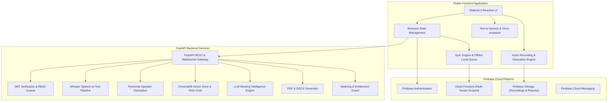

# VOXMIND ARCHITECTURE BLUEPRINT

Detailed design and architectural specifications for the VoxMind platform.

---

## 1. System Architecture Diagram

---

## 2. Layer Specifications

### A. Presentation Layer (Flutter)
- **Framework**: Flutter (Channel Stable) with Web and Mobile rendering support.
- **State Management**: Riverpod (`StateNotifierProvider`, `FutureProvider`, and `.select()` memoization for zero unnecessary rebuilds).
- **Navigation**: Declarative GoRouter with reactive route protection and workspace-gated paths.
- **Design System**: Material 3 with high-contrast accessibility tokens, adaptive sizing, and semantic labels.

### B. Service Layer (FastAPI Backend)
- **Engine**: Python 3.11 with FastAPI ASGI microservices.
- **Security**: Custom `SecurityHeadersMiddleware`, in-memory rate limiting, and RBAC dependency injection (`require_organization_member`, `require_admin_or_owner`).
- **AI Pipelines**:
  - Speech Recognition: Whisper STT.
  - Diarization: Speaker identification & speaking duration analytics.
  - Intelligence: Structured LLM output for summaries, action items, risks, and decisions.
  - Conversational RAG: Semantic search and question answering with source citations.

### C. Data & Persistence Layer
- **Cloud Firestore**: Multi-tenant database partitioned by `organizationId`. Client operations protected by hardened `firestore.rules`.
- **Firebase Storage**: Audio recordings and generated PDF/DOCX reports secured via `storage.rules`.
- **Offline Persistence**: Local `shared_preferences` queue with client-side idempotency keys for zero-loss network recovery.
